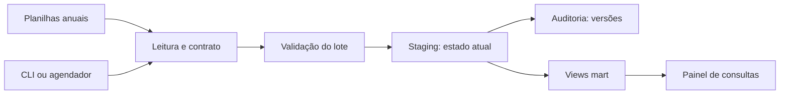

# 1. O mapa da biblioteca 🏛️

Uma biblioteca precisa de recepção, catálogo e sala de consulta. Misturar tudo no
mesmo balcão funciona no começo, mas torna mudanças arriscadas.

| Componente | Responsabilidade | Analogia de software |
|---|---|---|
| `contract.py` | Vocabulário de cabeçalhos aceitos | Contrato de entrada |
| `extract.py` | Excel → linhas canônicas e validação das chaves | Adaptador de entrada |
| `pipeline.py` | Coordena o caso de uso e regras de qualidade | Camada de aplicação |
| `repository.py` | SQL, transações e bloqueio por ano | Adaptador de persistência |
| `config.py` | Resolve configurações na execução | Configuração externa |
| `cli.py` | Argumentos, manifesto e códigos de saída | Interface para operadores |
| `queries.py` / `painel.py` | Consulta e apresentação | Interface para usuários |
| `sql/` | Evolução explícita da estrutura | Migrações de banco |

A CLI e o painel compartilham o banco, mas a consulta não dispara ingestão.
Isso permite que o agendador seja trocado sem reescrever a regra de negócio.
Não adicionamos interfaces abstratas e frameworks para cada função: os módulos
já separam os pontos que têm motivos diferentes para mudar.

**Staging e mart nesta entrega:** staging guarda o estado vigente textual;
`mart.projetos` é um contrato de consulta explícito sobre ele. O schema `dw` continua
reservado. Ainda não há tabela fato nem dimensões conformadas. Isso é uma central
operacional de consulta, uma base para o futuro Data Mart analítico.

Por que não começar com Airflow e dezenas de serviços? Hoje existe um fluxo pequeno,
acionável por comando, com arquivos anuais. Orquestração distribuída só agrega valor
quando dependências, volume, SLA e operação justificarem seu custo.

Referências oficiais consultadas:
[INSERT e ON CONFLICT](https://www.postgresql.org/docs/current/sql-insert.html),
[transações no Psycopg](https://www.psycopg.org/psycopg3/docs/basic/transactions.html),
[exportação no Streamlit](https://docs.streamlit.io/develop/api-reference/widgets/st.download_button).
